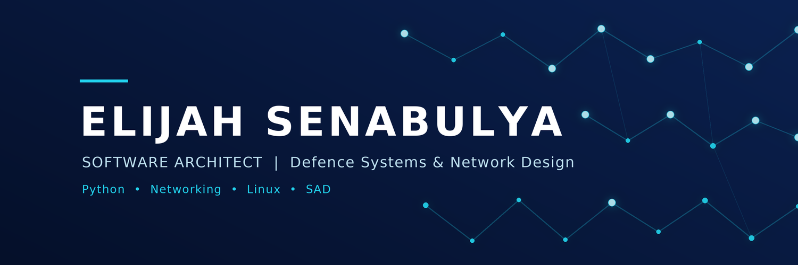

  

# Hi, I'm Elijah 👋

I'm a Software Engineering student at **Victoria University Kampala**, working toward a career as a **network software engineer**. I like understanding how things connect: how a request leaves a browser, crosses a network, and lands on a server that answers it.

## What I'm about

- 🎓 BSc Software Engineering, Victoria University Kampala
- 🌐 Interested in web infrastructure: how sites and services are built, hosted, and kept running
- 🐧 I work on Linux day to day
- 🎯 Goal: network software engineering

## Tech stack

| Area | What I use |
| --- | --- |
| Languages | Python, JavaScript |
| Environment | Linux, VS Code |
| Focus | Web infrastructure, networking |

## GitHub stats

  
  

## Let's connect

<!-- Replace each URL with your real link, then delete this comment -->

Built in Kampala, Uganda 🇺🇬

